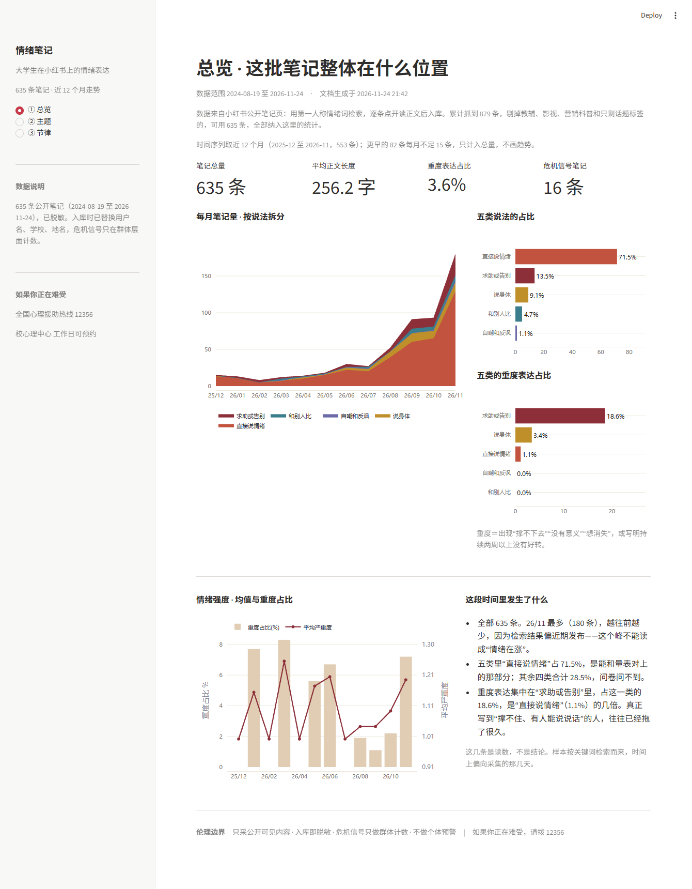
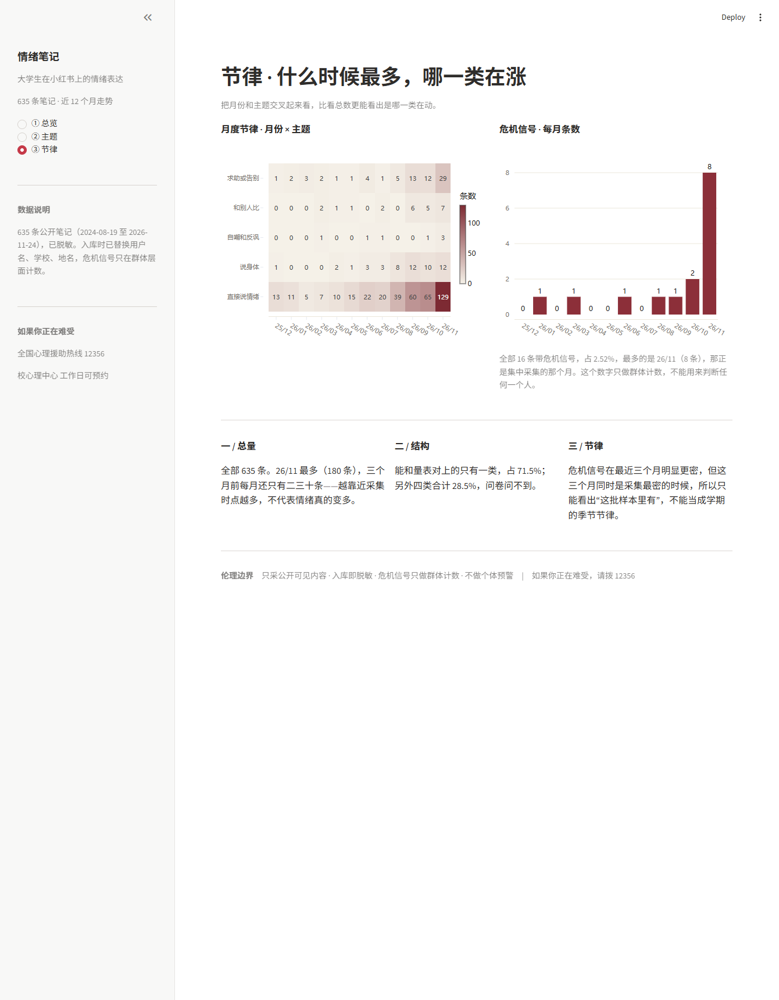

# 🪺 情绪笔记

**大学生在小红书上的情绪表达：从日常抱怨到危机求助**

《数据分析与可视化》课程个人项目 · 西南财经大学 · 丁瑞祺（42512098）

线上版本：https://dongriqing-emotion.streamlit.app

---

## 这是什么

学校做心理普查，用的是一份量表：最近两周有没有情绪低落、有没有失去兴趣。量表问的是"有没有"，问不到"怎么说的"。

但大学生在社交平台上写自己的难受时，写法差得很远。有人直接说"我最近很抑郁"；有人只写身体——连续两周三点睡、吃不下饭、掉头发；有人写"精神状态良好"配一张崩溃的图，字面是正的反过来才是真的；有人写"室友保研了，我还在改简历"；还有人写到最后已经越过了求助线。

这五种写法里，只有第一种能和量表对上。后面四种，问卷基本问不到。

这个项目要做的，是把"说法"先分开，再看每类说法在什么时间变多，最后做成一个能点开看的东西。它不是诊断工具，也不针对任何一个人。

## 界面

三个页面。这一页是总览，回答"最近整体在什么位置"。



| ② 主题 · 一类说法长什么样 | ③ 节律 · 哪几周最密 |
|:---:|:---:|
|  |  |

## 现在做到哪一步

已经跑通的是整条链路：抓取 → 标注 → 统计 → 三页可视化。

2026 年 11 月 21 日至 24 日，用第一人称情绪词在小红书上搜索，逐条点开笔记读正文，入库 879 条。剔掉教辅、影视、营销科普和纯标签的笔记，再减去正文不足 15 字的，剩 635 条整理进 `data/posts.csv`，每条带主题、严重程度、危机标记；`code/02_analyze.py` 从这份表现算月度分布、五类占比和热力图矩阵；`app.py` 只负责把算好的数字画出来。页面上的每个数字都能从 CSV 一步步算回来。

时间跨度、五类说法的占比、重度和危机信号的分布，都对着开题时写下的三条命题看。

## 三个页面分别看什么

**① 总览** 回答"整体怎么样"。左上是一个月一个月的笔记量按说法堆起来，能看出哪一类在涨；右边是五类占比和各类的重度表达占比；下面把平均严重度和重度占比画在一张图上——均值会被大量轻度笔记拉平，重度占比才看得出抬升。

**② 主题** 回答"这一类长什么样"。选一类，看它近 12 个月的走势、严重程度分布、高频词和最典型的几条原话。自嘲那一类在真实样本里只有 7 条——反讽的写法很难被关键词检索到，这一类的占比看个量级就行。

**③ 节律** 回答"什么时候最多"。月份乘主题的热力图，加上危机信号的每月条数。这里只出群体计数，不落到任何一条笔记。

## 数据与方法

**规模** 635 条，2024-08-19 至 2026-11-24，25 个月里都有样本。平均正文 256 字，中位 144 字。做时间序列时只取近 12 个月（2025-12 至 2026-11，553 条），更早的每个月不足 15 条，铺不开，只计入总量。

**怎么采的** 2026 年 11 月 21 日至 24 日，分七轮抓取。做法是打开真实浏览器，用第一人称的说法搜索（我好累、撑不住了、心里堵得慌、室友的一句话让我难受、在图书馆坐到想哭），逐条点开笔记读正文再存下来，每条之间隔二十多秒。一共存下 879 条，去重后逐条读一遍，把教辅真题、影视追剧、营销科普和只有标签的剔掉，再减去不足 15 字的，剩 635 条入库。

搜索会带出两年前的老帖，所以入库的笔记时间跨度超过两年。这不是刻意取的长期样本，是检索结果本来就这样。

用第一人称词而不是"失眠、内耗"这类话题词，是因为后者搜出来一半是教辅和科普。代价是样本天然偏向"直接说情绪"这一类，见下面已知局限。

**五类说法** 判定有先后顺序，不是关键词匹配：

| 顺序 | 说法 | 判据 |
|---|---|---|
| 1 | 求助或告别 | 出现指向结束、告别、直接求救的话 |
| 2 | 自嘲和反讽 | 字面是正的、读起来是反的，或靠行为构成反讽 |
| 3 | 说身体 | 身体是叙述主体（不是顺带提一句熬夜） |
| 4 | 和别人比 | 有具体的比较对象：某个人、某个排名、某个 offer |
| 5 | 直接说情绪 | 以上都不是，直接讲自己的感受 |

判到哪一步"是"就停下来，不往下走。边界案例和容易吵起来的几条写在 `code/标注手册.md` 里。

**严重程度** 看功能受损，不看情绪词有多重。轻度是还上得了课、吃得下饭；中度是已经影响到具体的事（连续失眠、旷课、作业交不上）；重度是出现"撑不下去""没有意义"，或者明确写了持续两周以上且没有好转。

**危机信号** 单独一项，和主题分开标，可以同时成立。只认四种：明确说到死或消失、交代后事、告别语、直接求助。抱怨累、说想休学不算。

**处理流程** `data/posts.csv` 是整理好的原始表 → `code/02_analyze.py` 分周、分词、算热力图矩阵，写出 `data/stats.json` → `app.py` 读这两份文件渲染三页。

## 本地运行

```bash
git clone https://github.com/dongriqing/my-first-github-project.git
cd my-first-github-project
python -m venv .venv
# Windows: .venv\Scripts\activate    macOS/Linux: source .venv/bin/activate
pip install -r requirements.txt
streamlit run app.py
```

浏览器会自己打开 `http://localhost:8501`。不需要任何密钥，不联网也能跑。

想自己验一遍数字是怎么来的，跑一条命令：

```bash
python code/02_analyze.py        # 从 posts.csv 重新计算 stats.json
```

跑完 `stats.json` 除了开头记录的生成时间，其余与仓库里那份完全一致。也就是说页面上的每个数字都能从 CSV 一路算回来，不是手工填的。

## 目录结构

```
├── app.py                  # Streamlit 应用：三个页面
├── requirements.txt        # 运行依赖
├── README.md               # 本文件
├── images/                 # README 里用的三张界面截图
├── data/
│   ├── posts.csv           # 635 条笔记，12 个字段
│   └── stats.json          # 统计结果，app.py 直接读
└── code/
    ├── 02_analyze.py       # 按月分组、分词、热力图矩阵、危机计数，写 stats.json
    └── 标注手册.md          # 五类怎么判、边界案例、一致性怎么算
```

抓取脚本没放进来：它要接管一个已经登录的浏览器会话，换台机器跑不起来，留在本地。

## 云端部署

用 Streamlit Community Cloud，直连本仓库，`git push` 后自动更新。入口是 `app.py`，分支 `main`。

## 已知局限

**平台和时间** 只有小红书一个平台。样本横跨 2024 年 8 月到 2026 年 11 月，但这不是按时间抽的样——搜索带出什么就是什么，所以两个月前后可能一条都没有。看的是这些笔记里的公开表达，不外推到大盘，也不当成长期趋势。

**采集时点** 抓取集中在 11 月 21 至 24 日，搜索默认按最新排序，结果是 2026 年 11 月的条数明显比前面几个月多。这是采集时间造成的，不是情绪真的在涨，所以月度曲线只看形状和结构，不读绝对高低。

**抽样偏差** 关键词都是第一人称的情绪说法，抓到的自然多是"直接说情绪"，占 71.5%。自嘲和反讽只有 7 条，不是平台上没人这么写，是这类反讽很少带那些检索词。所以五类的占比反映的是"这样搜能搜到什么"，不等于平台全貌。

**人群** 平台上发声的大学生偏城市、偏年轻女性，和"大学生"这个总体不完全重合。这一点是选题的前提——问卷覆盖不到的那部分表达，恰好集中在这里。

**标注口径** 五类按固定顺序判定，边界案例的处理规则写在 `code/标注手册.md` 里。所以看占比看的是量级和走势，小数点后一位不必当真。

**危机信号** 按高召回设定，宁可多记一条。这个数字是上限估计，适合看哪几周抬升、集中在哪类说法里，不适合当成绝对人数。

## 伦理边界

只采公开可见内容；入库时就把用户名、学校、地名替换掉，不留原文；危机信号只在分析层做计数，不进展示层；每一页底部固定放求助信息；不针对任何一条笔记、任何一个人做判断。

如果你正在难受，全国心理援助热线是 **12356**。

## 使用说明

课程作业，代码可以参考，引用时注明来源是课程作业就行。
