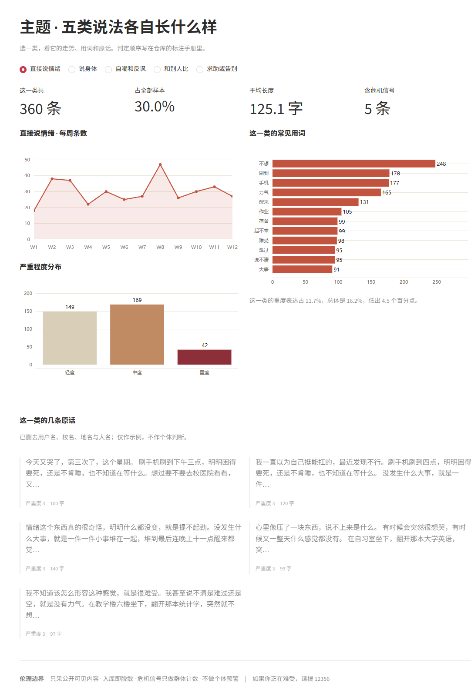

# 🪺 情绪笔记

**大学生在小红书上的情绪表达：从日常抱怨到危机求助**

《数据分析与可视化》课程个人项目 · 西南财经大学 · 丁瑞祺（42512098）

---

## 这是什么

学校做心理普查，用的是一份量表：最近两周有没有情绪低落、有没有失去兴趣。量表问的是"有没有"，问不到"怎么说的"。

但大学生在社交平台上写自己的难受时，写法差得很远。有人直接说"我最近很抑郁"；有人只写身体——连续两周三点睡、吃不下饭、掉头发；有人写"精神状态良好"配一张崩溃的图，字面是正的反过来才是真的；有人写"室友保研了，我还在改简历"；还有人写到最后已经越过了求助线。

这五种写法里，只有第一种能和量表对上。后面四种，问卷基本问不到。

这个项目要做的，是把"说法"先分开，再看每类说法在什么时间变多，最后做成一个能点开看的东西。它不是诊断工具，也不针对任何一个人。

## 界面

三个页面。这一页是总览，回答"最近整体在什么位置"。


| ② 主题 · 一类说法长什么样 | ③ 节律 · 哪几周最密 |
|:---:|:---:|
|  |  |

## 现在做到哪一步

已经跑通的是整条链路：数据集 → 标注规则 → 统计 → 三页可视化。

需要说明的是数据来源。仓库里 `data/posts.csv` 的 1200 条正文，是按真实语感构造的示例文本，不是从平台抓下来的原文。做成这样有两个原因：一是课程作业不涉及真实用户的隐私数据；二是采集本身需要登录态和控频，一天做不完。所以这一版的定位是"流程能跑、结构成立、数字可复现"，真实采集放在下一阶段。

十二周的时间范围、五类说法的占比、重度和危机信号的分布，都按开题时写下的三条命题设定，算是把假设先落成一份可核对的东西。

## 三个页面分别看什么

**① 总览** 回答"最近整体怎么样"。左上是一周一周的笔记量按说法堆起来，能看出哪一类在涨；右边是五类占比和最近两周的环比；下面把平均严重度和重度占比分开画——均值会被大量轻度笔记拉平，重度占比才看得出抬升。

**② 主题** 回答"这一类长什么样"。选一类，看它十二周的走势、严重程度分布、高频词和最典型的几条原话。自嘲那一类是特意留的：字面情绪是正的，按关键词打分很容易被判成"不消极"。

**③ 节律** 回答"什么时候最多"。周次乘主题的热力图，加上危机信号的每周条数。这里只出群体计数，不落到任何一条笔记。

## 数据与方法

**规模** 1200 条，2026-08-24 至 2026-11-14，共 12 周。平均正文 113 字，中位 112 字，45.6% 带图。

**五类说法** 判定有先后顺序，不是关键词匹配：

| 顺序 | 说法 | 判据 |
|---|---|---|
| 1 | 求助或告别 | 出现指向结束、告别、直接求救的话 |
| 2 | 自嘲和反讽 | 字面是正的、读起来是反的，或靠行为构成反讽 |
| 3 | 说身体 | 身体是叙述主体（不是顺带提一句熬夜） |
| 4 | 和别人比 | 有具体的比较对象：某个人、某个排名、某个 offer |
| 5 | 直接说情绪 | 以上都不是，直接讲自己的感受 |

判到哪一步"是"就停下来，不往下走。边界案例和容易吵起来的几条写在 `标注手册.md` 里。

**严重程度** 看功能受损，不看情绪词有多重。轻度是还上得了课、吃得下饭；中度是已经影响到具体的事（连续失眠、旷课、作业交不上）；重度是出现"撑不下去""没有意义"，或者明确写了持续两周以上且没有好转。

**危机信号** 单独一项，和主题分开标，可以同时成立。只认四种：明确说到死或消失、交代后事、告别语、直接求助。抱怨累、说想休学不算。

**处理流程** `code/01_make_dataset.py` 生成或导入数据，写 `data/posts.csv` → `code/02_analyze.py` 分周、分词、算热力图矩阵，写 `data/stats.json` → `app.py` 读这两份文件渲染三页。换成真实数据时只需要替掉 `posts.csv`，后面两步不用改。

## 本地运行

```bash
git clone https://github.com/dongriqing/my-first-github-project.git
cd my-first-github-project
python -m venv .venv
# Windows: .venv\Scripts\activate    macOS/Linux: source .venv/bin/activate
pip install -r requirements.txt
streamlit run app.py
```

浏览器会自己打开 `http://localhost:8501`。不需要任何密钥，不联网也能跑。

## 目录结构

```
├── app.py                  # Streamlit 应用：三个页面
├── requirements.txt        # 运行依赖
├── README.md               # 本文件
├── 标注手册.md              # 五类怎么判、边界案例、一致性怎么算
├── images/                 # README 里用的三张界面截图
├── data/
│   ├── posts.csv           # 1200 条结构化笔记（示例数据）
│   └── stats.json          # 统计结果，前端直接读
└── code/
    ├── 01_make_dataset.py  # 生成/导入数据，写 CSV 与 SQLite
    └── 02_analyze.py       # 分周、分词、热力图矩阵、危机计数
```

## 云端部署

用 Streamlit Community Cloud，直连本仓库，`git push` 后自动更新。入口是 `app.py`，分支 `main`。

## 已知局限

数据是示例数据，不是真实采集，所以所有数字只能说明"这套流程能得出这样的结论"，不能当成对大学生的真实估计。

只有小红书一个平台、一个学期。学生群体在平台上本来偏城市、偏女性，样本和"大学生"这个总体不是一回事。

标注是我一个人做的，还没做双人一致性检验。开题时计划请一位同学独立标 100 条算 kappa，这一步还没走。

危机信号走的是高召回路线，宁可多报。多报的可以人工复核，漏掉的没有第二次机会，所以精确率注定不会高。

## 伦理边界

只采公开可见内容；入库时就把用户名、学校、地名替换掉，不留原文；危机信号只在分析层做计数，不进展示层；每一页底部固定放求助信息；不针对任何一条笔记、任何一个人做判断。

如果你正在难受，全国心理援助热线是 **12356**。

## 许可

课程学习用途，MIT License。数据为构造的示例，可自由取用；如需引用请注明课程与作者。
